

Taskati

---
###  Welcome Screens
<table align="center">
  <tr>
    <td align="center">
      <b>Splash Screen</b>  
      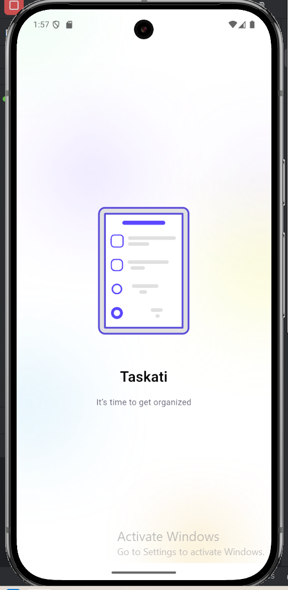
    </td>
    <td align="center">
      <b>Upload Screen</b>  
      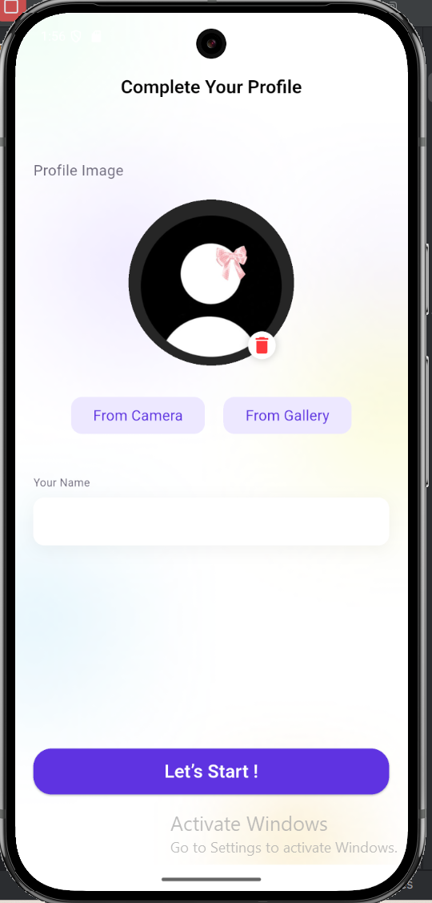
    </td>
  </tr>
</table>
###  Home Screens
<table align="center">
  <tr>
    <td align="center">
      <b>Home1 Screen</b>  
      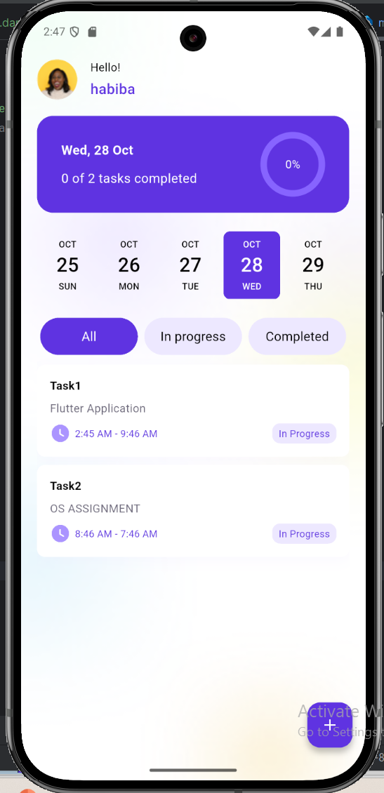
    </td>
    <td align="center">
      <b>Home2 Screen</b>  
      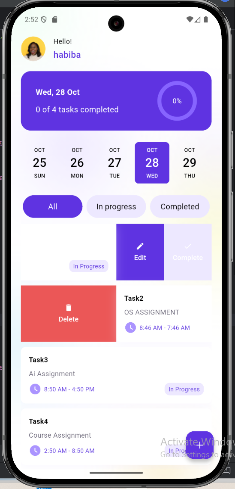
    </td>
    <td align="center">
      <b>Home3 Screen</b>  
      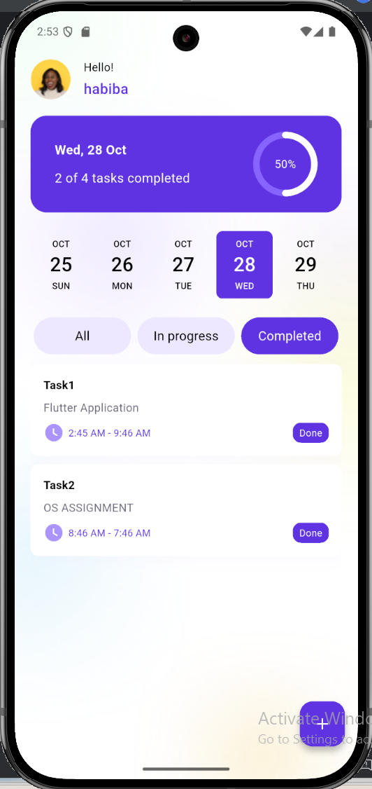
    </td>
    <td align="center">
      <b>Home4 Screen</b>  
      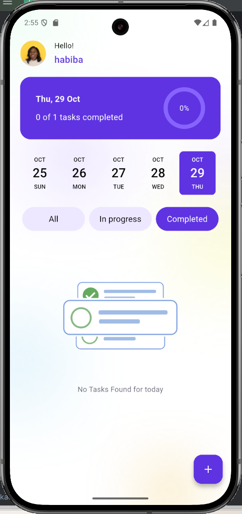
    </td>
  </tr>
</table>
###  Task Screens
<table align="center">
  <tr>
    <td align="center">
      <b>Task1 Screen</b>  
      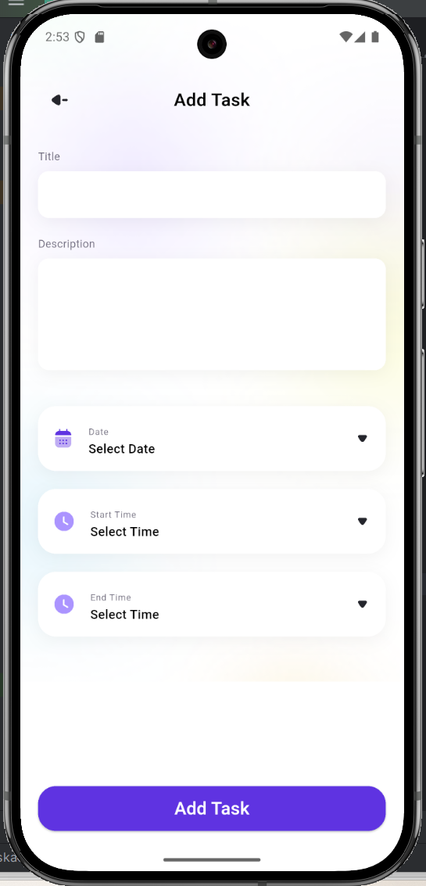
    </td>
    <td align="center">
      <b>Task2 Screen</b>  
      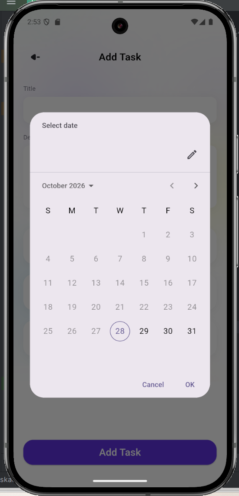
    </td>
    <td align="center">
      <b>Task3 Screen</b>  
      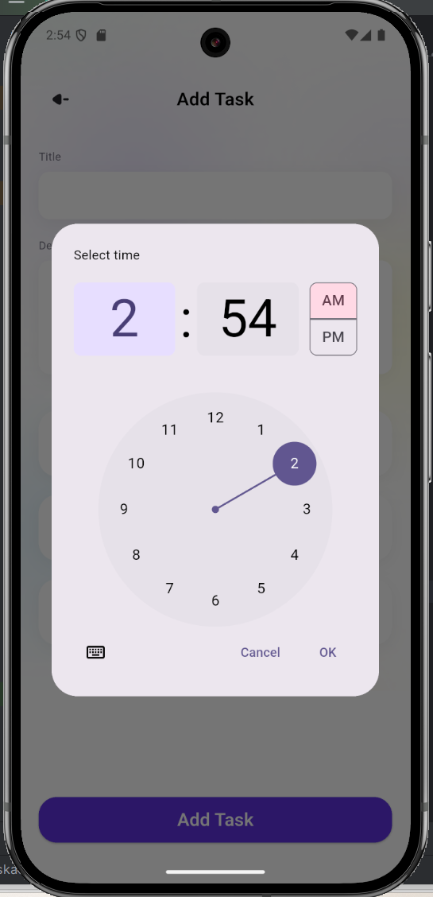
    </td>
    <td align="center">
      <b>Task4 Screen</b>  
      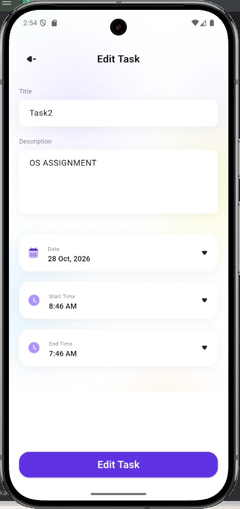
    </td>
  </tr>
</table>
###  Dark Screens
<table align="center">
  <tr>
    <td align="center">
      <b>Splash Screen</b>  
      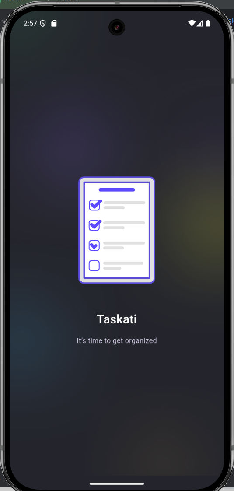
    </td>
  </tr>
</table>

